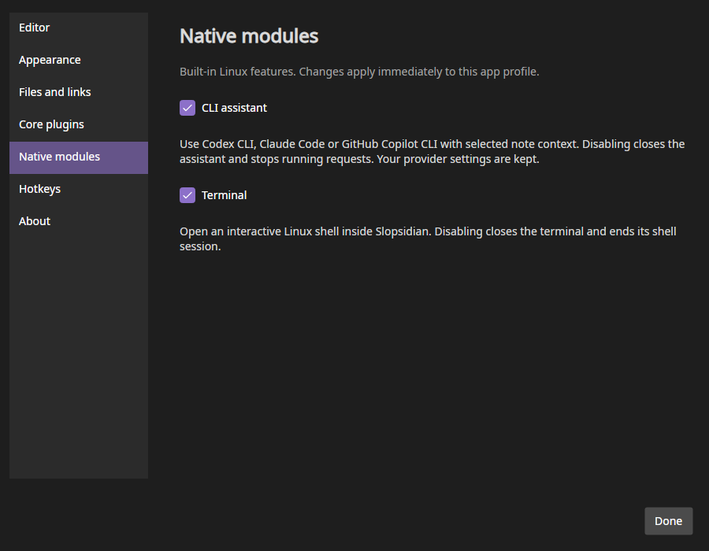
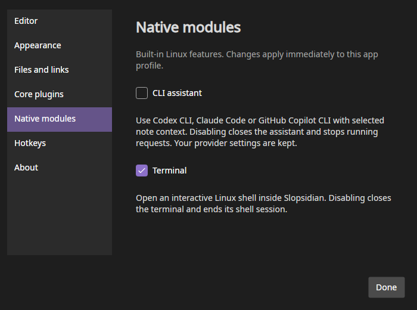
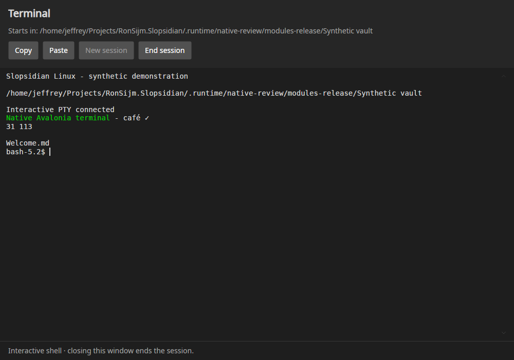
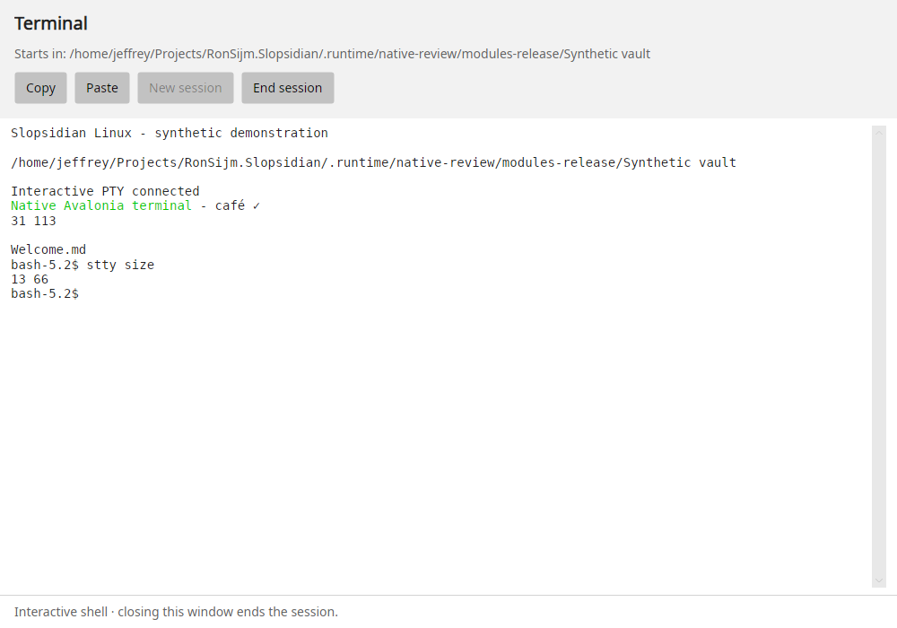

# Native modules and terminal review

Release: **0.3.0-preview.2**. Branch: `feat/assistant-module`.

## Delivered workflows

Settings → Native modules independently enables/disables CLI assistant and
Terminal. Choices persist immediately in the private native profile, including
without an open vault. Disabling closes the corresponding window; assistant
requests are cancelled and the terminal PTY is released. Enabling exposes the
ribbon/command without launching a process. Provider executable/model settings
and vault core-plugin configuration are retained. A failed save restores the
previous choice and displays the error.

Terminal uses Iciclecreek.Avalonia.Terminal 4.1.4, XTerm.NET 3.0.3 and Porta.Pty
2.2.4 with native Avalonia rendering and Linux PTY libraries. No Electron,
Chromium, WebView or JavaScript host is introduced. It starts in the active
vault or home, supports normal shell input, Unicode/ANSI, resizing, copy/paste,
interrupt, explicit session end/restart and recoverable launch errors. Shell
history and intentionally detached processes follow ordinary Linux behavior.

## Verification

- Strict `tools/lint-native.sh`: CSharpier 1.4.0, dotnet format style, .NET
  recommended analyzers and SonarAnalyzer C#; zero warnings/errors.
- Release xUnit v3/headless suite: **344 passed, zero failed/skipped**, including
  nine new native module/real-PTY cases. Tests use temporary vaults and explicit
  `/bin/bash --noprofile --norc -i`, never developer shell startup scripts.
- Native module tests cover backward-compatible defaults, no-vault persistence,
  provider preservation, request cancellation, ribbon/palette availability,
  direct command guards, pending-save controls and failed-save rollback.
- Actual PTY tests exercise starting directories with spaces, `test -t 0`, UTF-8
  output, Ctrl+C, exit status, fresh-buffer restart and process cleanup on
  module disable/application close. Missing directories show recoverable errors.
- NuGet transitive vulnerability query reported no affected packages. The
  resolved application graph contains 39 packages and no Electron, Chromium,
  WebView, CEF or JavaScript/Node host dependency.
- Real X11 captures on a private Xvfb display: settings at 900×700 and 700×520,
  terminal at 1000×700 and 600×400, dark/light, ended session and launch error.
  `stty size` changed from 31×113 to 13×66 after resizing. Synthetic vault and
  real shell commands; no paid-provider verification is implied.

## Screenshots

The existing neutral/violet identity, native fonts, spacing and application
icon are preserved. This is a narrow extension, not full port-parity acceptance.
Independent finish review and documentation comparison are recorded when done.

## Design continuity and independent review

### Disposition

**SHIP.** Independent source and rendered-capture comparison found no blocking
visual or interaction findings in this native Operate extension.

### Material findings

Terminal and Command palette reuse the existing `command` ribbon icon. Their
separate tooltips, accessible names and palette labels distinguish the actions;
the repeated glyph is a minor, non-blocking ambiguity. No other material
in-scope design drift was found.

### Preserved strengths

`App.axaml` remains the visual authority: neutral dark/light surfaces, violet
Fluent selections, the existing Segoe UI/Noto Sans interface stack at 14, native
button treatment and thin icon geometry. The settings page retains the existing
200-wide navigation, 28-unit page margin, 20-unit spacing and 24-unit heading.
Terminal chrome uses the same resource brushes and button treatment, with the
existing DejaVu Sans Mono convention for shell content. Clear starting-directory
text, explicit session actions, wrapping descriptions and visible ended/error
feedback remain readable at the reviewed minimum sizes. Program-provided ANSI
colors are shell output.

### Evidence and coverage

Reviewed current `NativeSettingsWindow.cs`, `NativeTerminalLayout.axaml`,
`NativeTerminalWindow.cs`, `MainWindow.axaml`, module/terminal/command flows,
`NativeProfile.cs`, and both new test files. Compared all nine final captures in
`.impeccable/review/modules/`: `workspace-modules.png`, `modules-dark.png`,
`modules-narrow-disabled.png`, `modules-light.png`, `terminal-dark.png`,
`terminal-narrow.png`, `terminal-light.png`, `terminal-ended.png` and
`terminal-error.png`, plus the earlier native settings Editor and Appearance
captures. Source confirms immediate persisted module choices, save rollback,
availability guards and window cleanup. Release engineering verification above
records strict lint clean and 344 passing tests; this documentation review did
not rerun them. Native Avalonia controls require no web detector.

### Remaining limits

No `PRODUCT.md`, `DESIGN.md` or design sidecar exists; incumbent source and
captures supply continuity evidence. Existing dark-theme Fluent selection and
`AccentBrush` use different violet values in the baseline, retained as existing
roles. No pre-existing drift repair was needed for this scope. This record adds
no design tokens or visual world and changes no source or captures. It does not
extend acceptance to full port parity, every Linux desktop, assistive technology
or paid-provider execution.
