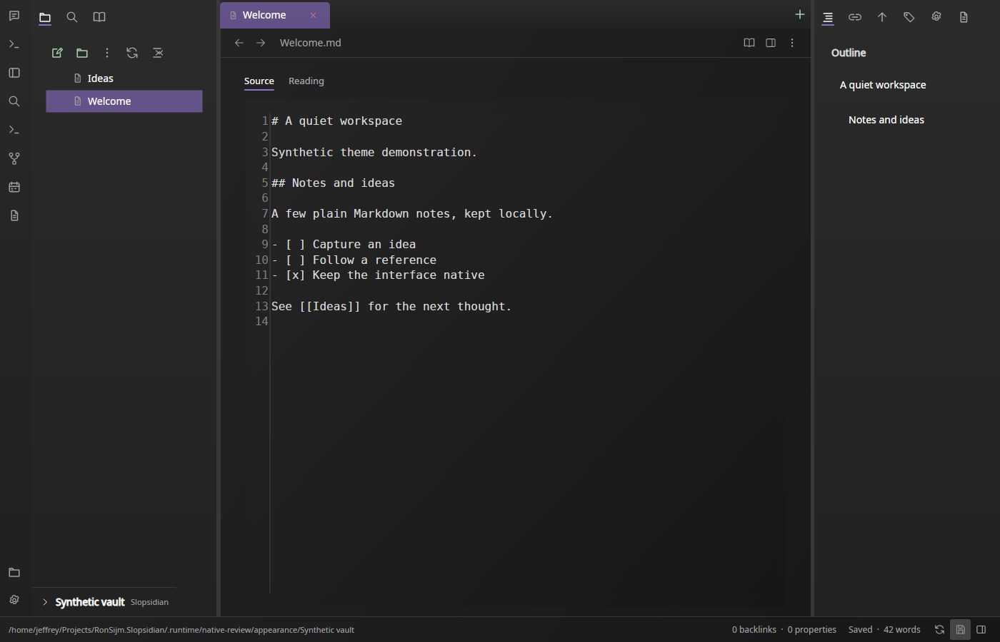
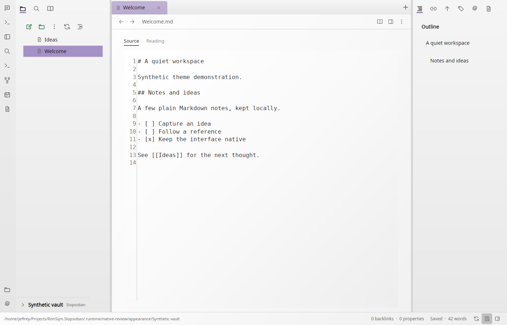
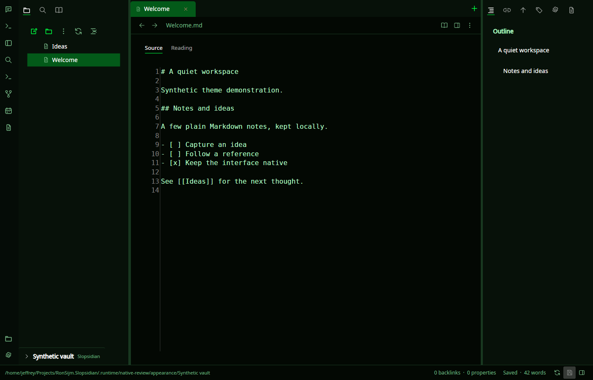
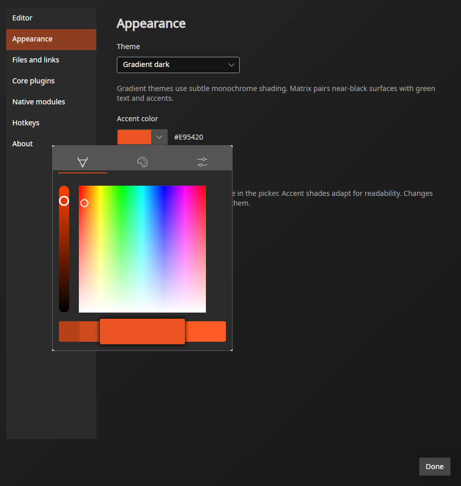

# Native Appearance presets and accent colors

Release **0.3.0-preview.3** adds Appearance customization after the error-action
work recorded separately for the same release.

## Behavior

Settings → Appearance provides Dark, Light, System, Gradient dark, Gradient light
and Matrix. The gradient presets use only neutral gray/white/black stops. Matrix
uses near-black surfaces, pale green body text and a neon green default accent.
The original flat palettes, typography, layout and icon geometry are retained.

A native Avalonia ColorPicker provides spectrum, palette, RGB and hex input,
without alpha. A custom RGB choice is retained across presets; Use theme default
returns to the current preset’s accent. Text and control accent shades derive
readable colors while retaining the stored selected hex. Changes preview
immediately; Done persists them. Closing Settings restores the saved appearance
while retaining independent immediate native-module choices.

Terminal buffers use solid preset backgrounds for ANSI rendering, while window
chrome follows the selected theme. Switching themes does not restart the PTY.
No Electron, WebView, browser host or JavaScript runtime is introduced.

## Verification

- Strict CSharpier/style/.NET/SonarAnalyzer lint: zero warnings/errors.
- Full Release xUnit v3/headless suite: **371 passed, zero failed/skipped**.
- Eighteen Appearance cases cover monochrome gradients, readable foregrounds,
  Matrix colors, derived accent contrast, native picker/reset, preview/cancel,
  independent module changes, saved/reloaded choices, rejected invalid RGB,
  backward-compatible profiles and a live PTY’s PID/input across all new themes.
- Actual private-Xvfb captures show all three new presets in real settings and
  editing windows, the 700×520 minimum settings size, native RGB/hex picker and
  custom orange accent. Notes are synthetic. No user desktop was automated.
- The second/final builder inspection batch corrected selection contrast and
  enabled the picker’s components tab. The independent finish review returned
  **ship**, with no material findings and all nine final captures verified.

## Screenshots

The approved preset/palette additions and incumbent native roles are recorded in
the project design documents after the independent documentation comparison.

## Design-system continuity

The scoped documentation comparison used source commit
`bb1ac4e119f82edc437e5c4483e5e95bdb61f65c` on
`feat/appearance-customization`. CodeMCP was bound to this repository with a ready
index and active watcher; resource and behavior conclusions were checked against
the current native source. The context launcher remained unavailable, so the
existing source and review packet supplied context.

The approved appearance expansion is now recorded in root `DESIGN.md` and
`.impeccable/design.json`. The token-bearing frontmatter extracts 46 existing
color roles/stops, the native UI/editor typography, and observed spacing,
document-tab shape and component properties. The sidecar maps those values back
to actual Avalonia resource keys and records variant inheritance, all 14 neutral
gradient stops, native component sources and accent derivation policy. It adds
no synthetic palette, tonal ramp or HTML component translation.

The comparison preserves these distinctions:

- Dark's native `AccentBrush` and default Fluent control violet are intentionally
  different. Light's default native and Fluent accent values coincide.
- Gradient dark/light inherit their flat bases and override only surface,
  sidebar and ribbon brushes. Every gradient stop has equal RGB channels.
- Matrix supplies its near-black and green roles while inheriting Dark error
  roles. The original fonts, icon geometry and layout remain the visual baseline.
- Custom RGB is stored exactly; text and control colors derive independently to
  meet 4.5:1 contrast against conservative pane anchors and white selection text.
  These are algorithms, not new fixed accent tokens.
- `TerminalSurfaceBrush` stays solid under every preset; theme switching retains
  the existing PTY. Preview, Done, cancel and theme-default reset behavior are
  documented with the independent native-module persistence boundary.

All nine final private-Xvfb captures in `.impeccable/review/appearance` were opened
for the documentation comparison: the three workspace presets, three Appearance
pages, minimum-size settings, native picker and custom-accent workspace. The
900×950 picker image intentionally shows the spectrum tab and the available
components/sliders tab. RGB and hex inputs are enabled in native source and are
accessed through that components tab; the spectrum image does not display those
fields. The existing finish-review **ship** disposition and parent-run lint/test
results above remain the release evidence. This pass changed only the two new
design documents and this continuity record.
