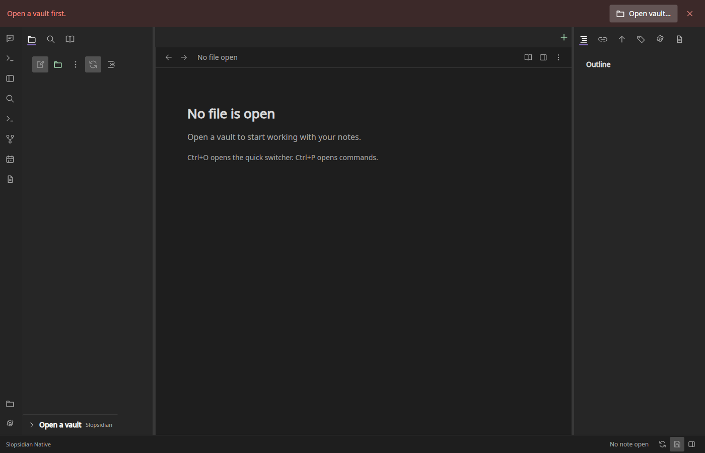
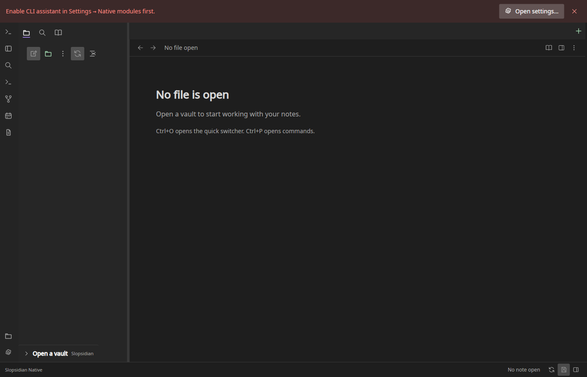
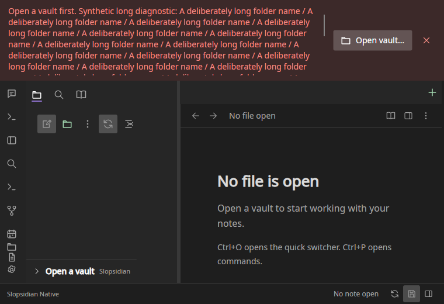

# Native error recovery actions

Release **0.3.0-preview.3**, branch `fix/actionable-errors`.

## Behavior

Missing-vault errors include **Open vault…** for the existing native chooser,
which supports opening a folder and creating a new vault. Disabled assistant
and terminal errors include **Open settings…** for Native modules directly.
Actions use explicit error metadata rather than matching diagnostic wording.
Unknown failures retain their message and dismiss control.

Cancelling keeps the original error. Completing the required step clears that
error; a newer failure is retained. Buttons are disabled during an operation or
recovery and duplicate events cannot open multiple dialogs. No failed command
is automatically retried. Long diagnostics scroll inside a 120-unit area so the
recovery and dismiss controls remain visible at minimum window size.

## Verification

- Nine new headless xUnit cases cover keyboard activation, native chooser
  open/create/cancel, duplicate events, module settings navigation and independent
  enablement, unknown errors, busy states, newer failures and long/narrow text.
- Strict CSharpier/style/.NET/SonarAnalyzer lint passed with zero warnings/errors.
- An initial full run hit one existing Canvas focus assertion; its isolated
  recheck passed. The repeated Release suite passed all **353 cases, zero
  failed/skipped**, without source changes between those runs.
- Actual private-Xvfb captures cover dark/light, minimum 760×520 with a synthetic
  long diagnostic, native vault chooser, disabled-module settings and an unknown
  error without an action. No real notes or developer desktop automation.

## Captures

The existing native error colors, neutral surfaces, font stack and icon geometry
remain the visual authority. This change adds no Electron, WebView, dependency,
design token or new visual system. Independent review/documentation results are
recorded below.

## Design continuity and independent review

### Disposition

**SHIP.** Independent finish review found no material in-scope visual or
interaction findings. The documentation comparison confirms this ordinary
native Operate refinement preserves the incumbent interface.

### Material findings

No material in-scope design drift was found. The existing vault chooser's Cancel
control remains below the fold at 640×600 and is reachable by scrolling; Escape
also cancels. That unchanged chooser layout is outside this banner refinement.

### Preserved strengths

`App.axaml` retains authority for neutral dark/light surfaces, violet selections,
the Segoe UI/Noto Sans interface stack, native button styling and source icon
geometry. The banner retains its error brushes and dismiss cross. Recovery adds
a familiar folder/settings icon and a direct action beside the diagnostic.
The 120-unit message scroll area keeps recovery and dismiss controls visible at
760×520. Error text contrast remains **5.70:1 dark** and **6.16:1 light**.
The existing distinct dark `AccentBrush` and Fluent selection violets retain
their established roles; no baseline drift was repaired.

### Evidence and coverage

Compared the finished error-banner change with the incumbent `MainWindow.axaml`
and `App.axaml`, and inspected all seven final captures in
`.impeccable/review/errors/`: `error-vault-dark.png` (1400×900),
`error-vault-light.png` (1400×900), `error-vault-narrow-long.png` (760×520),
`error-vault-chooser.png` (640×600), `error-module-dark.png` (1400×900),
`error-module-settings.png` (900×700) and `error-generic.png` (1400×900).
The final independent review covered source and those same rendered states;
no UI edits followed the captures.

Verified execution logs record nine passing actual-control/headless cases for
keyboard activation, open/create/cancel, duplicate dialogs, Native modules
navigation, busy states, newer/unknown errors and long narrow diagnostics.
Strict lint is clean and the repeated full Release suite passed 353/353 as
recorded above. This documentation pass inspected that evidence without
rerunning the tests. Native Avalonia requires no web detector.

### Remaining limits

This record adds no product/design document, sidecar, tokens, assets or visual
world, and changes no source or captures. The review covers the error recovery
extension and its existing native destinations; it does not establish full port
parity, behavior on every Linux desktop or assistive-technology coverage.
