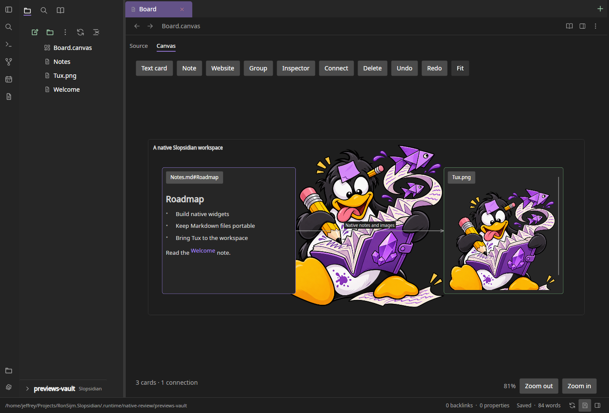
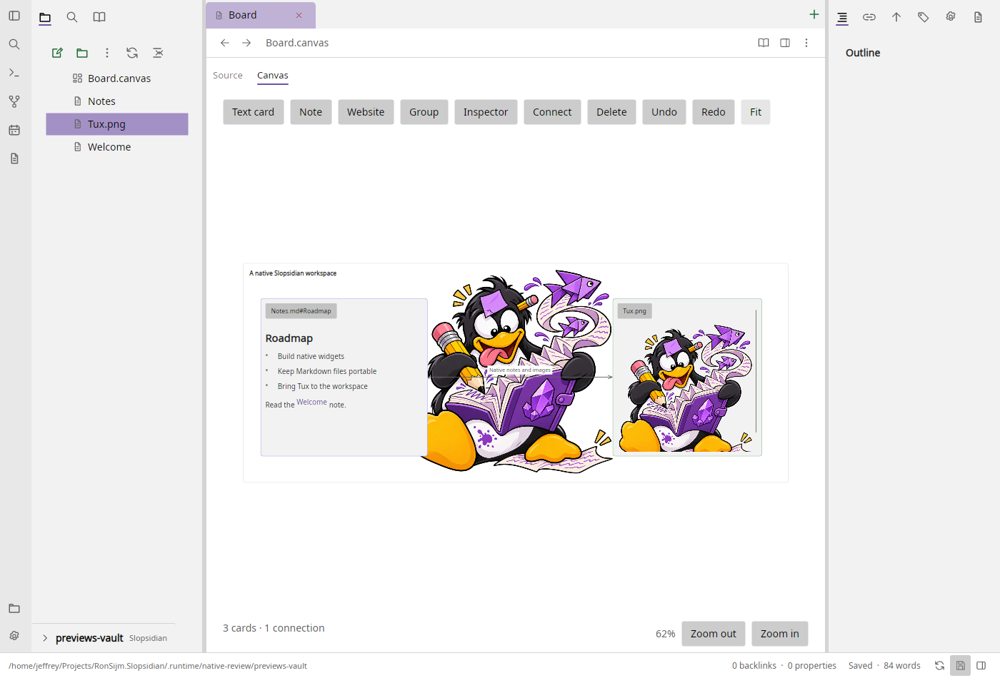
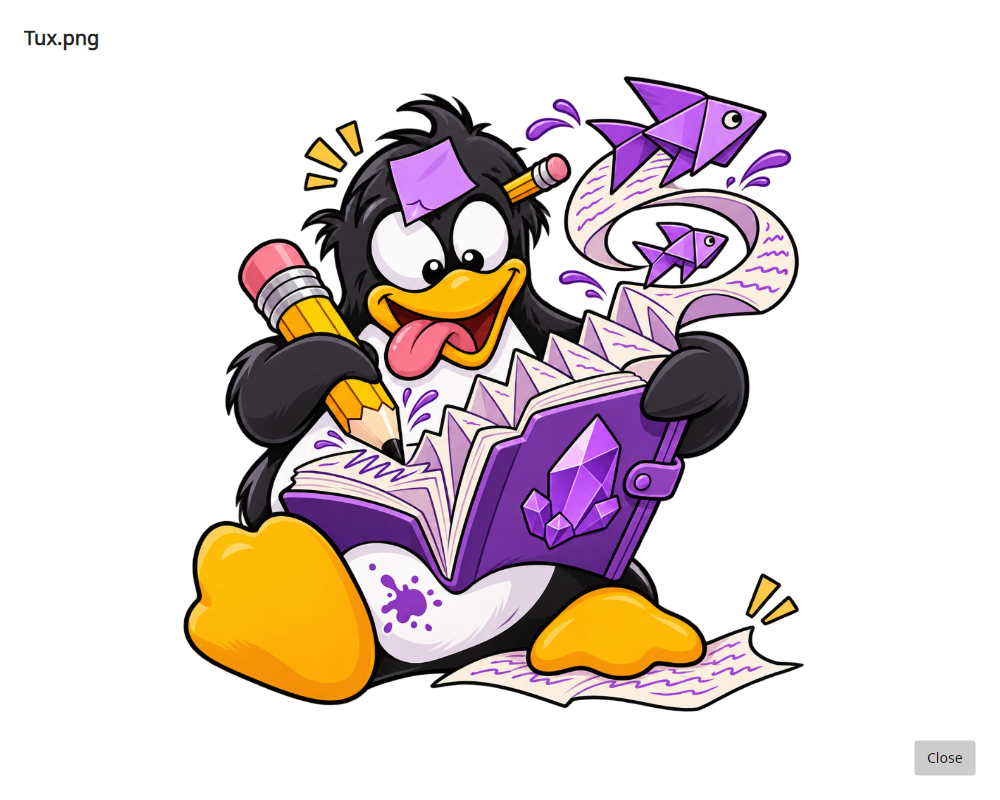

<p align="center">
  
</p>

# Slopsidian Linux

An independent, native Linux client for Slopsidian, built with **.NET 10 and
Avalonia 12**. Local Markdown vaults, native widgets and a slightly unhinged Tux.

**Preview: 0.2.0-preview.2.** The full feature port is in progress. This is a
separately maintained Linux fork of Ron Sijm’s Slopsidian; it is not an official
Obsidian client.




## What works today

- Local vaults, file navigation, independent tabs, session restore and retained drafts.
- Markdown editing, native reading, search, YAML properties and linked-note panels.
- Guarded saves, reference-aware renames, saved-file history and reviewed trash recovery.
- Native Canvas cards, connections, an inspector, note sections and image previews.
- An interactive graph, bookmarks, daily notes, templates and named workspaces.
- Dark/light appearance, native settings and an independent Linux version number.

The desktop process uses Avalonia widgets throughout. It requires no Electron,
Chromium, WebView, Blazor, browser server, Node.js or npm.

Bases, advanced Markdown/Live Preview, full attachment workflows, slides, audio,
complete upstream parity and community JavaScript plugin compatibility remain
unfinished. See [the native roadmap](Docs/Project/NATIVE-PORT.md).

## Run from source

Install the .NET 10 SDK and Linux desktop dependencies, then run:

```sh
./build-and-run-linux.sh
# Or select a vault directly:
./build-and-run-linux.sh --vault=/absolute/path/to/vault
```

Use `--profile=/absolute/path` for isolated app state. Existing native profiles
remain in `Slopsidian/native` under the application-data directory.

## Build, test and format

```sh
dotnet restore Slopsidian.Linux.sln
dotnet build Slopsidian.Linux.sln -c Release --no-restore
dotnet test tests/RonSijm.Slopsidian.Linux.Tests -c Release --no-build
./tools/lint-native.sh
# Apply the pinned formatter:
dotnet tool restore
dotnet csharpier format src/RonSijm.Slopsidian.Linux tests/RonSijm.Slopsidian.Linux.Tests
```

CSharpier keeps our code consistently formatted. The lint gate also runs
`dotnet format style`, recommended .NET analyzers and SonarAnalyzer C#, with build
warnings treated as errors. The xUnit v3 suite exercises real headless Avalonia
controls and temporary vaults. See [contributing](CONTRIBUTING.md).

## Packages and versions

GitHub Actions builds self-contained **x64 and arm64** archives and Debian
packages. Download build artifacts from the repository’s Actions tab. Public
releases are published separately by a maintainer; tag builds prepare drafts.

```sh
./tools/package-linux.sh linux-x64  # or linux-arm64
```

Packages and checksums appear in `.runtime/native-linux/<runtime>/out/`.
Extract `Slopsidian-Linux-<version>-<runtime>.tar.gz` and run `./slopsidian-linux`.
The package includes its .NET runtime; system desktop libraries are still needed.
Supported targets use glibc, with Ubuntu 22.04 or newer as the packaging baseline.
Packages are currently unsigned and have no automatic update channel.

The project file owns the version used by About, `--version`, packages and
`linux-v<version>` tags. See [versioning](Docs/Features/NATIVE-LINUX-VERSIONING.md)
and [the client guide](Docs/Features/NATIVE-LINUX.md).

## Screenshots

Actual Linux application captures with synthetic demonstration notes:





## Upstream and credits

Original Slopsidian by **Ron Sijm**:
https://github.com/RonSijm/RonSijm.Slopsidian

Linux fork:
https://github.com/jericonclusion/Slopsidian.Linux

We retain the upstream history and attribution. Useful changes to shared vault
logic and formats can be incorporated selectively; the native interface is
maintained here. The workflow is documented in CONTRIBUTING.md.

The Tux notebook artwork and its generation/edit provenance are in
`src/RonSijm.Slopsidian.Linux/Assets/`. Dependency notices are in `tools/linux/`;
the source icons retain their license in `Assets/icons-LICENSE.txt`.
The inherited source tree does not declare a repository-wide license. This fork
does not invent one or change the original authors’ rights.
