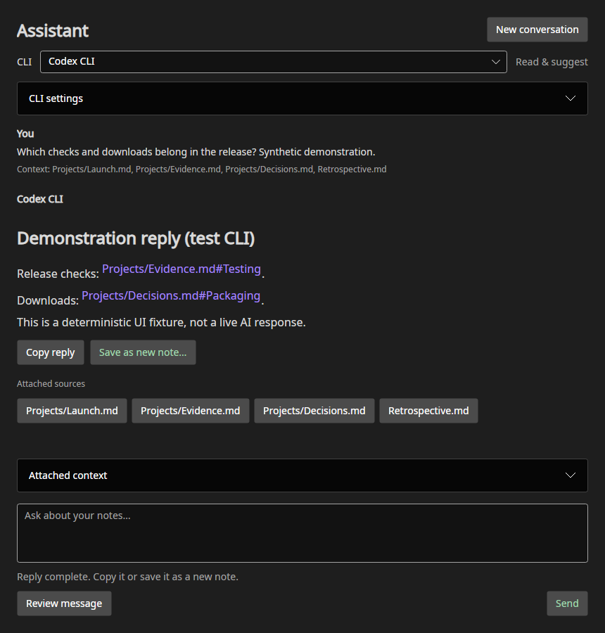
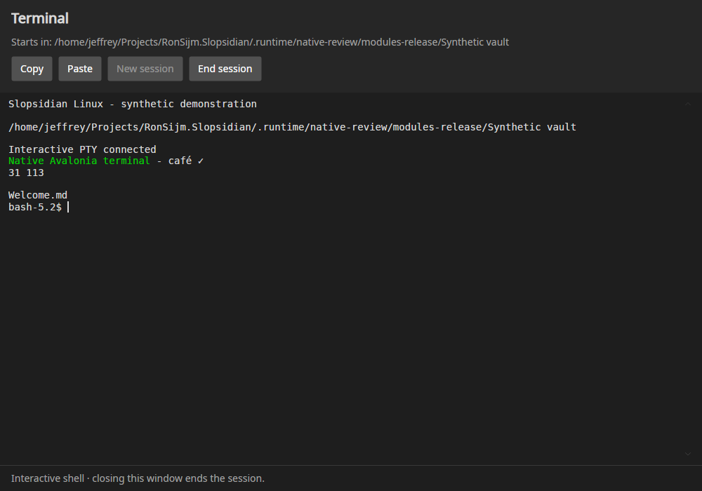

<p align="center">
  
</p>

# Slopsidian Linux

A native Linux notebook for local Markdown vaults, built with **.NET 10 and
Avalonia 12**. Keep your notes, links and writing tools in one desktop workspace.

**Preview: 0.3.0-preview.2.** Independently developed for Linux. The feature set
is growing; the current capabilities and remaining work are listed below.

Ready-to-run downloads: https://github.com/jericonclusion/Slopsidian.Linux/releases/tag/linux-v0.3.0-preview.2




## What works today

- Local vaults, file navigation, independent tabs, session restore and retained drafts.
- Markdown editing, native reading, search, YAML properties and linked-note panels.
- Guarded saves, reference-aware renames, saved-file history and reviewed trash recovery.
- Native Canvas cards, connections, an inspector, note sections and image previews.
- An interactive graph, bookmarks, daily notes, templates and named workspaces.
- A native assistant for Codex CLI, Claude Code and GitHub Copilot CLI, with note
  snapshots, selections, linked notes, backlinks, source navigation and saved replies.
- A native interactive terminal with copy/paste, resizing and explicit session restart.
- Independent assistant/terminal switches under **Settings → Native modules**.
- Dark/light appearance, native settings and an independent Linux version number.

The desktop process uses Avalonia widgets throughout. It requires no Electron,
Chromium, WebView, Blazor, browser server, Node.js or npm.

Bases, advanced Markdown/Live Preview, full attachment workflows, slides, audio,
complete module workflows and community JavaScript plugin compatibility remain
unfinished. See [the native roadmap](Docs/Project/NATIVE-PORT.md).

## Download a ready-to-run build

**Preview 0.3.0-preview.2:**
https://github.com/jericonclusion/Slopsidian.Linux/releases/tag/linux-v0.3.0-preview.2

| Linux system | Debian / Ubuntu package | Portable archive |
| --- | --- | --- |
| Intel / AMD 64-bit | [Download .deb](https://github.com/jericonclusion/Slopsidian.Linux/releases/download/linux-v0.3.0-preview.2/slopsidian-linux_0.3.0-preview.2_amd64.deb) | [Download tar.gz](https://github.com/jericonclusion/Slopsidian.Linux/releases/download/linux-v0.3.0-preview.2/Slopsidian-Linux-0.3.0-preview.2-linux-x64.tar.gz) |
| ARM 64-bit | [Download .deb](https://github.com/jericonclusion/Slopsidian.Linux/releases/download/linux-v0.3.0-preview.2/slopsidian-linux_0.3.0-preview.2_arm64.deb) | [Download tar.gz](https://github.com/jericonclusion/Slopsidian.Linux/releases/download/linux-v0.3.0-preview.2/Slopsidian-Linux-0.3.0-preview.2-linux-arm64.tar.gz) |

These builds include .NET; **you do not need to compile the app or install the
.NET SDK**. For Debian/Ubuntu, download the matching `.deb` and install it:

```sh
sudo apt install ./slopsidian-linux_0.3.0-preview.2_amd64.deb
slopsidian-linux
```

Use the `arm64` package on ARM. With an archive, extract it and run the included
`slopsidian-linux` launcher. Linux desktop libraries are still required. SHA-256
checksum files are attached to the release. This is an unsigned preview; the
unfinished workflows listed above still apply.

## Use your CLI assistant

Install and sign in to **Codex CLI**, **Claude Code** or **GitHub Copilot CLI**
in a terminal, then open **Assistant** from the ribbon or command palette.
Choose your CLI and attach the notes or selected text you want it to use.
Linked notes and backlinks can be added explicitly; **Review message** shows
exactly what will be sent, including any unsaved snapshot.

The assistant is an optional built-in module. Enable or disable it under
**Settings → Native modules**; switching it off stops requests and keeps your
provider settings. Obsidian community JavaScript plugins are not supported.

Press **Ctrl+Enter** to send. Follow citations back to your notes, copy a reply
or save it as a new note. This preview supports reading and suggestions;
conversations last while their window is open. Provider login, availability and
usage charges belong to the selected CLI. See the [assistant guide](Docs/Features/NATIVE-ASSISTANT.md)
for setup, context limits and supported CLI versions.

## Open a terminal

Choose **Terminal** in the ribbon or **Terminal: Open an interactive shell**
in the command palette. It starts your Linux shell in the open vault, or your
home directory when no vault is open. Use **Ctrl+C** to interrupt and
**Ctrl+Shift+C/V** to copy/paste. **New session** restarts an ended shell.
Closing the terminal or disabling its module ends that session.

The terminal runs ordinary commands with your user permissions and can change
files. The assistant keeps its separate read-and-suggest workflow. See the
[terminal guide](Docs/Features/NATIVE-TERMINAL.md).



## Run from source

Install the .NET 10 SDK and Linux desktop dependencies, then run:

```sh
./build-and-run-linux.sh
# Or select a vault directly:
./build-and-run-linux.sh --vault=/absolute/path/to/vault
```

Use `--profile=/absolute/path` for isolated app state. Existing native profiles
remain in `Slopsidian/native` under the application-data directory.

## Build, test and format

```sh
dotnet restore Slopsidian.Linux.sln
dotnet build Slopsidian.Linux.sln -c Release --no-restore
dotnet test tests/RonSijm.Slopsidian.Linux.Tests -c Release --no-build
./tools/lint-native.sh
# Apply the pinned formatter:
dotnet tool restore
dotnet csharpier format src/RonSijm.Slopsidian.Linux tests/RonSijm.Slopsidian.Linux.Tests
```

CSharpier keeps our code consistently formatted. The lint gate also runs
`dotnet format style`, recommended .NET analyzers and SonarAnalyzer C#, with build
warnings treated as errors. The xUnit v3 suite exercises real headless Avalonia
controls and temporary vaults. See [development and contributions](CONTRIBUTING.md).

## Packages and versions

GitHub Actions builds self-contained **x64 and arm64** archives and Debian
packages. Download build artifacts from the repository’s Actions tab. Public
releases are published separately by a maintainer; tag builds prepare drafts.

```sh
./tools/package-linux.sh linux-x64  # or linux-arm64
```

Packages and checksums appear in `.runtime/native-linux/<runtime>/out/`.
Extract `Slopsidian-Linux-<version>-<runtime>.tar.gz` and run `./slopsidian-linux`.
The package includes its .NET runtime; system desktop libraries are still needed.
Supported targets use glibc, with Ubuntu 22.04 or newer as the packaging baseline.
Packages are currently unsigned and have no automatic update channel.

The project file owns the version used by About, `--version`, packages and
`linux-v<version>` tags. See [versioning](Docs/Features/NATIVE-LINUX-VERSIONING.md)
and [the client guide](Docs/Features/NATIVE-LINUX.md).

## Screenshots

Actual Linux application captures with synthetic demonstration notes:


## Credits

Slopsidian Linux began as a fork of [Slopsidian](https://github.com/RonSijm/RonSijm.Slopsidian)
by **Ron Sijm**. Its history and attribution are retained; Linux development
and releases are maintained in this repository. This is an independent project,
unaffiliated with Obsidian or the AI providers.

Asset provenance and icon notices are in `src/RonSijm.Slopsidian.Linux/Assets/`;
packaged dependency notices are in `tools/linux/`. The inherited source does not
declare a repository-wide license, and this fork does not change the authors’ rights.
